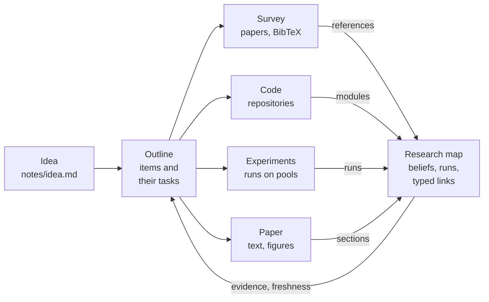
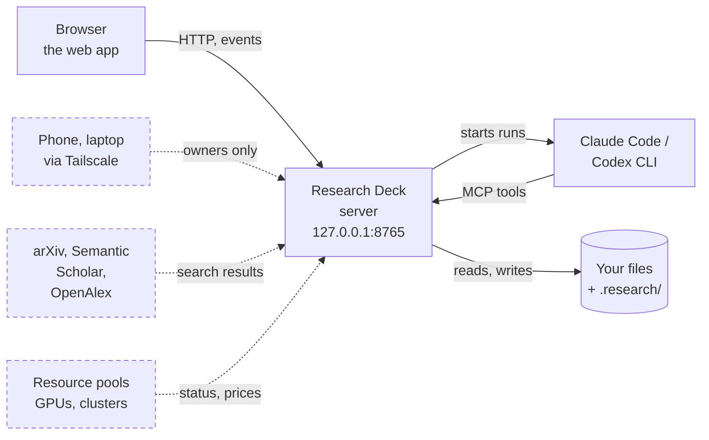

# Research Deck

[](https://github.com/RickWayne1125/research-deck/actions/workflows/ci.yml)
[](https://rickwayne1125.github.io/research-deck/)
[](LICENSE)

A local research dashboard over your project folders. You work from the paper's **outline** — what each section
argues, item by item, with the literature, code, figures and experiments each item needs — over a **research map** that
keeps what you tried, what is confirmed, what a change invalidates and which experiments must be rerun, and one **AI
conversation per project**, backed by the Claude Code or Codex CLI, next to your paper, your experiments and your code.
Chinese and English UI.

本地运行的科研工作台：以论文提纲为主线（每一节要论证什么、每一条需要哪些文献、代码、图和实验），下面是一张「研究地图」管理想法、
证据和实验之间的依赖（尝试过什么、哪些已确认、改动之后哪些要复核或重跑），每个项目一个 AI 对话（Claude Code 或 Codex），旁边是
稿件、实验和代码。界面支持中文和英文。


## What it does

| View | |
|---|---|
| **Outline** (home) | The paper's sections, each a chain of numbered items (2.1, 2.2; sub-items 3.1.1, at any depth; parallel items framed together), grouped by phase (idea → insight → design → evaluation) with what leaving the current one takes. Write and reorder items like an outliner (↵, ⌥↵, Tab, ⇧Tab). Each item gets tasks — literature, code, figure, experiment — tracked as done, in progress, not started or blocked, and what they produce is its evidence. A design direction or a problem to validate is a fork: choose one, and the others fold away (the research tree keeps them, with why they were given up). Also a task board, the research tree, and any item as the root. Templates (systems, ML, workshop, your own) are editable in Settings. At the top: what needs you now (agent proposals, drafts, decisions, runs, forks to choose, blocked tasks). |
| **Map** | The research DAG as a list grouped by stage (or as a graph), opened from the outline. Rows show only exceptions; one opens in place with what it rests on, what depends on it, and the options of a decision — choosing one previews its impact first. Review drafts with J / K / Y / N. |
| **Experiments** | Runs with their freshness from the map, the log in a read-only terminal that follows the file, the run plan for what must be rerun and what it costs, and the resource pools: this computer, GPU boxes, clusters and cloud allocations read through one protocol (rd-pool/1), with their prices and the agents' budgets. |
| **Paper** | Edit `.tex` / `.md` with preview, the outline of the section at the cursor beside the text (which items are written, which not yet; draft or check the section against them); **AI proofread** runs fixed passes (typos → terminology → wording) and shows suggestions in the text to accept or reject. Figures: draw.io in the official embedded editor, matplotlib with live preview, OmniGraffle / DataGraph when installed; an AI edit is shown as a diff before anything is written. |
| **Code** | Git history and diffs of the project's repositories, AI code review and explanations. |
| **Conversation** (⌘J) | One thread per project, whichever view you ask from; what you are looking at is attached. Switch between Claude and Codex and the context is handed over. Model, effort and Fast sit behind one button. |

Agents never change the map or the outline directly: what they draft is *proposed* until you accept it, and every change shows its
impact (which nodes need a review, which experiments a rerun) before it is applied. ⌘K jumps anywhere.

**New from an idea.** Paste an idea (or upload a .md, .txt or .pdf) and Research Deck creates the project folder
(`~/Research/<name>` by default; `~/research` on Linux, `%USERPROFILE%\Research` on Windows; change it in Settings),
keeps the idea in `notes/idea.md` and runs an **early survey**: it searches arXiv, Semantic Scholar and OpenAlex,
downloads the open-access PDFs into `papers/` (paywalled ones get a link and BibTeX), writes `papers/references.bib`
and `notes/survey.md`, and drafts the problem and reference nodes for you to review. It never runs experiments.
The map then grows **one step at a time**: the next step is drafted from the confirmed nodes of the one before, several
directions may run side by side, and an abandoned or refuted node grows no new branch.

**Zotero and Docmost (optional).** A project can keep its papers in a **Zotero** collection instead of files: the
survey stores each paper and its PDF there (through the Zotero app or zotero.org), and the project keeps only
`references.bib`, exported from the collection. Its notes can follow a **Docmost** page: sign in once in a window
that Research Deck opens, bind a page, and every `notes/*.md` becomes a page under it, one way. A page edited in
Docmost is never overwritten; it waits for your review. See the
[guide](https://rickwayne1125.github.io/research-deck/guide/zotero-docmost/).


## How it models research



A project keeps one **research map** in `.research/`: a build graph of beliefs (the problem, references, findings,
designs, claims) and the actions that back them (experiments, scripted figures), joined by typed links (evidence,
basis, implements, describes, cites). The **outline** is the paper's argument kept on that map, and each item's tasks
send work out. Survey, code, experiments and writing do not depend on one another: each records its own kind of node
(references, modules, runs, sections), and they meet only on the map. Evidence flows back to the items it backs, and
freshness carries a change across the workstreams: edit the code, and the runs that read it go stale, while the claims
they back and the paragraphs that describe those claims are flagged for review. Claude and Codex can work in any of
them, but what they change on the map arrives as a proposal, with its impact shown, until you accept it. Details:
[docs/DAG.md](docs/DAG.md).


## How it fits together



Everything runs on your computer. The server listens on 127.0.0.1 only and keeps its state in each project's
`.research/` folder and in `~/.research-deck/`. It runs your own Claude Code or Codex CLI headless, and the agents
reach back to it through MCP tools. The dashed parts are optional: the survey runs when you start it, the pools you add
are read for their status and prices, and Tailscale is there only if you set it up. Details:
[docs/ARCHITECTURE.md](docs/ARCHITECTURE.md).


## Quick start

Requirements: macOS or Linux, Python 3.12+, Node.js 20+ with pnpm (`corepack enable`), git. For the AI parts, the
[Claude Code](https://docs.claude.com/en/docs/claude-code) and/or [Codex](https://github.com/openai/codex) CLI, signed
in. Optional: draw.io, OmniGraffle or DataGraph for native figures.

```bash
git clone https://github.com/RickWayne1125/research-deck.git && cd research-deck
python3.12 -m venv .venv && .venv/bin/pip install -e '.[test]'
scripts/dev.sh                    # installs and builds the web app, then serves http://127.0.0.1:8765
```

On first start a demo project (`toycache`, a made-up cache-eviction study with a small DAG, runs, a paper and two
figures) is created in `~/.research-deck/demo/`. Add your own project from the project menu: **New from an idea…**
(above), or **Add an existing folder…** with its kind — **research** (the full pipeline) or **engineering** (code,
documents, runs and figures, without the map).
Research Deck keeps its state in a `.research/` folder inside the project and never touches anything else.

```bash
RD_FAKE_AGENT=1 scripts/dev.sh    # try the UI without calling Claude or Codex (canned answers)
scripts/dev.sh --vite             # backend + Vite dev server with hot reload on http://127.0.0.1:5173
.venv/bin/python -m pytest -q     # backend tests
(cd web && pnpm test)             # frontend tests
```

## Configuration

Machine-local state lives in `~/.research-deck/` (`RD_LOCAL_DIR`): the project registry, the agents' token and
`settings.json` with your own defaults:

```json
{
  "agent_defaults": {"claude": {"model": "claude-opus-5-5", "effort": "high"}, "codex": {"effort": "high"}},
  "dag_defaults": {"gates": {"blocking": false}, "autocommit": {"enabled": false}, "stages": {"mode": "strict"}},
  "new_projects": {"dir": "~/Research", "git_init": true,
                   "survey": {"sources": ["arxiv", "semantic_scholar", "openalex"], "count": 15,
                              "download_pdfs": true, "papers_dir": "papers"}}
}
```

Each project's `.research/project.yaml` holds its name, kind, stage and where the paper, code, figures and experiment
records live; `.research/dag/config.yaml` holds the map's policy (gates, autocommit, what agents may queue).

**Run it as a service (macOS).** `scripts/launchd.sh install` adds a launchd user agent: it starts at login, restarts
if it exits and logs to `~/.research-deck/logs/server.log`. `restart` after an update, `status`, `uninstall`.

**Open it from your other devices (optional, Tailscale).** Add
`"tailnet": {"host": "<machine>.<tailnet>.ts.net", "https_port": 8765, "owners": ["you@example.com"]}` to
`settings.json`, restart, then `tailscale serve --bg --https=8765 http://127.0.0.1:8765` (tailnet only, never Funnel).
Requests through Serve are accepted only from the listed owners.

## Safety

The server listens on 127.0.0.1 only and refuses requests from other origins (a CSRF header is required for every
change, DNS rebinding is blocked). Agents run headless in the project folder: Claude Code restricted to the project
with only Research Deck's MCP server; Codex in a read-only sandbox unless you allow writes for the conversation.
Nothing submits jobs to remote machines or creates credentials. The early survey runs only when you start it: it
queries arXiv, Semantic Scholar and OpenAlex (no keys, nothing about you) and downloads open-access PDFs (public
addresses only, PDF files only, 60 MB at most). Everything else that reaches the network is something you set up: a
resource pool with a command or an HTTP source, read for its status and prices only; Zotero (the app on this computer,
or zotero.org with a key you keep in the Keychain); and your Docmost site, which alone gets its sign-in cookies. Secrets
Research Deck obtains itself stay in `~/.research-deck/secrets/` (owner-only files). Details:
[docs/ARCHITECTURE.md](docs/ARCHITECTURE.md) (Safety).

## Documentation

The documentation site, **<https://rickwayne1125.github.io/research-deck/>**, has the installation guide, a tour of
the demo, the user guide and examples. Its reference pages are in this repository:

- [docs/ARCHITECTURE.md](docs/ARCHITECTURE.md): how the pieces fit, conventions, safety, agents and context sharing
- [docs/API.md](docs/API.md): the HTTP API and on-disk formats
- [docs/DAG.md](docs/DAG.md): the research map's model — nodes, edges, freshness, impact preview, gates

## Contributing

See [CONTRIBUTING.md](CONTRIBUTING.md) for the development setup and the checks CI runs, and [SECURITY.md](SECURITY.md)
for reporting security problems.

## License

[Apache License 2.0](LICENSE). Redistributions keep the license and the [NOTICE](NOTICE) file.
