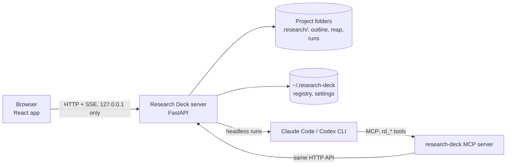

# Research Deck

Research Deck is a dashboard for one researcher's projects, running on your own machine. You work from the paper's
**outline**: what each section argues, item by item, with the literature, code, figures and experiments each item
needs. Underneath sits a **research map**: what you tried, what is confirmed, what a change invalidates and which
experiments must be rerun. Beside them are your experiments, your paper and your code, and **one AI conversation per
project**, backed by the [Claude Code](https://docs.claude.com/en/docs/claude-code) or
[Codex](https://github.com/openai/codex) CLI. The interface is in Chinese and English.

[Install it](getting-started/install.md){ .md-button .md-button--primary } [Take the tour](getting-started/quickstart.md){ .md-button }

## What you work with

| View | What it is for |
|---|---|
| **Outline** (home) | The paper's sections as chains of numbered items (2.1, 2.2; sub-items 3.1.1 at any depth), grouped by phase: idea → motivation & insight → system design → evaluation. Each item gets tasks (literature, code, figure, experiment), and what they produce becomes its evidence. Design directions branch into forks; the research tree keeps the abandoned ones with why they were given up. At the top: what waits for you. |
| **Experiments** | Run records with their freshness from the map, live logs, and the plan of what must be rerun. |
| **Paper** | `.tex` / `.md` editing beside the outline of the section at the cursor, AI proofreading, and figures (draw.io, matplotlib, OmniGraffle, DataGraph). |
| **Code** | Git history and diffs of the project's repositories, AI review and explanations. |
| **Map** | The research DAG behind it all: nodes, their edges, freshness, the impact of a change before it is applied. |
| **Conversation** (⌘J) | One thread per project, with whatever you are looking at attached. Switch between Claude and Codex and the context is handed over. |

## How it fits together

- **Local only.** The server listens on 127.0.0.1 and keeps its state in the project's `.research/` folder and in
  `~/.research-deck/`. Nothing submits jobs to remote machines or creates credentials.
- **Agents propose, you decide.** An agent's changes to the map or the outline come in as proposals or as dashed draft
  items; every change shows its impact (what needs review, what must rerun) before it is applied.
- **One source of truth.** The outline lives on the map, the paper points at outline items with markers, and tasks
  point at the map nodes they produce, so a stale experiment shows up on the item it backs.

## Where to go next

- [Installation](getting-started/install.md): requirements, setup, running it as a service.
- [A tour of the demo](getting-started/quickstart.md): ten minutes with the bundled `toycache` project.
- [The outline](guide/outline.md): the page you will spend most of your time on.
- [Examples](examples/idea-to-paper.md): from an idea to a written section.
- [Contributing](contributing.md): development setup, checks and how to send a change.
